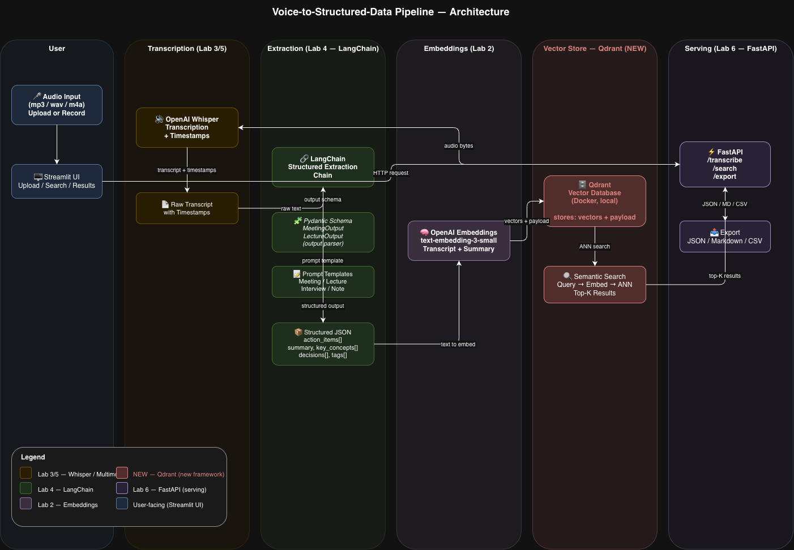

# Voice-to-Structured-Data Pipeline

Sanampreet Singh (IY1GIG) - sanampreet0900@gmail.com

<!-- Keep the specification to one or two pages. Replace every comment and placeholder with your own text. -->

## Introduction

Meetings, lectures, and voice notes contain valuable information that gets lost because manually reviewing audio is time-consuming. This project builds an end-to-end pipeline that accepts audio recordings, transcribes them using OpenAI Whisper, extracts structured data (action items, key concepts, summaries) via a LangChain extraction chain, and stores the results in a Qdrant vector database for semantic search across all past recordings.

## Main objectives

The system will allow a user to upload an audio file (mp3/wav/m4a), receive a timestamped transcript and structured JSON output (action items, decisions, key concepts, summary), and query across all past recordings using natural language. Audio types supported: meetings, lectures, interviews, and voice notes.

**Main features:**
- Audio upload and transcription with timestamps (Whisper)
- Structured field extraction per audio type (LangChain + Pydantic)
- Semantic search across past recordings (Qdrant)
- REST API + Streamlit UI for upload, search, and export

**Scope:** single-speaker audio up to ~30 minutes, English primary, batch processing only, no real-time streaming or speaker diarization.

## Data sources

| Source | URL | License | Size / Usage |
|--------|-----|---------|--------------|
| AMI Meeting Corpus | https://groups.inf.ed.ac.uk/ami/corpus/ | CC BY 4.0 | ~100h total; 30-meeting subset (~3h) used for evaluation |
| Common Voice (Mozilla) | https://commonvoice.mozilla.org/en/datasets | CC0 | ~10k clips; ~200 validation clips for WER evaluation |
| LibriSpeech test-clean | https://www.openslr.org/12 | CC BY 4.0 | ~5h total; ~50 clips for clean-speech baseline |
| Self-recorded samples | — | Own | ~10 clips for edge-case and demo testing |

AMI and LibriSpeech will be downloaded via their official scripts. Common Voice via the Hugging Face `datasets` library. No files over 50 MB will be committed to the repository; a `data/download.sh` script will be provided.

## Architecture

The pipeline flows left to right: the user uploads audio via Streamlit → FastAPI routes it to Whisper for transcription → the transcript is passed to a LangChain structured extraction chain (with Pydantic output schemas) → the structured output is embedded with OpenAI Embeddings → vectors and payload are stored in Qdrant → semantic search queries are handled by Qdrant's ANN index and results are returned to the UI.

## Used technologies

| Technology | Origin | Purpose in the project |
| --- | --- | --- |
| OpenAI Whisper | course (Lab 3/5) | Transcribes audio files to text with timestamps |
| LangChain | course (Lab 4) | Structured extraction chain: prompt → LLM → parsed output |
| Pydantic | course (Lab 4/6) | Defines output schemas (MeetingOutput, LectureOutput) for LangChain |
| OpenAI Embeddings | course (Lab 2) | Embeds transcripts and summaries into vectors for retrieval |
| FastAPI | course (Lab 6) | Serves /transcribe, /search, /export endpoints |
| Streamlit | course (Lab 6) | User-facing UI for upload, search, and results display |
| Qdrant | new | Vector database for persistent storage and filtered semantic search |

**Why Qdrant is essential:** Qdrant is the core persistence and retrieval layer. The course-stack alternatives (Chroma, FAISS) are in-memory and do not persist across sessions, and FAISS does not support filtered search by metadata (e.g. "search only meetings"). Without Qdrant the system cannot function as a searchable archive — it would be reduced to a one-shot transcription tool with no memory of past recordings.

## Evaluation plan

**Test set:** 30 manually curated audio clips with known ground-truth outputs — 10 meeting clips (AMI corpus, labeled action items and decisions), 10 lecture clips (LibriSpeech + self-recorded, labeled key concepts), 10 edge-case clips (heavy accent, background noise, technical jargon).

| Component | Metric | Baseline |
|-----------|--------|----------|
| Transcription | WER (Word Error Rate) | Whisper `tiny` vs. `base` vs. API |
| Extraction | F1 on extracted fields | Raw GPT-4o-mini (no structured prompt) vs. LangChain + Pydantic chain |
| Retrieval | Hit rate @ 3 | BM25 keyword search vs. Qdrant semantic search |
| Latency | Median + p95 (seconds) | Measured end-to-end per audio clip |

At least 3 concrete failure cases will be documented with root cause analysis (e.g. Whisper mishearing domain-specific terms, LLM hallucinating action item owners, retrieval failing on short queries). LLM-generated extractions will be manually verified on 10+ examples.
